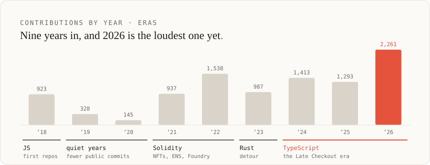
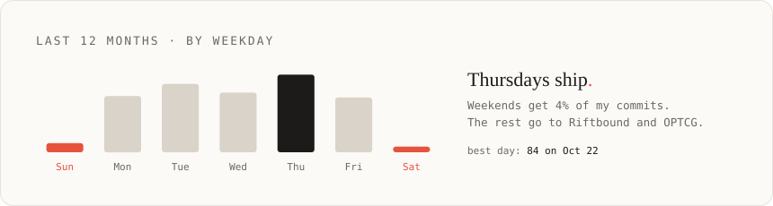

<a href="https://julian.so">
  <picture>
    <source media="(prefers-color-scheme: dark)" srcset="./assets/header-dark.svg">
    
  </picture>
</a>

### On the desk right now

- 🛠️ **Building** software at [Late Checkout](https://github.com/latecheckout)
- 📖 **Reading** *Zen and the Art of Motorcycle Maintenance*, 20% in ([library](https://julian.so/library))
- 🃏 **Playing** Riftbound and the One Piece TCG on weekends (see the chart below, it's true)
- 📷 **Shooting** photos, kept at [julian.so/photos](https://julian.so/photos)

### Nine years of commits, in eras

<picture>
  <source media="(prefers-color-scheme: dark)" srcset="./assets/eras-dark.svg">
  
</picture>

I started on GitHub in 2017 writing JavaScript. In 2021 I went down the Ethereum rabbit hole: NFT drops, rebuilding ENS from scratch, and Foundry everything. A short Rust and Neovim detour followed, and these days it's TypeScript all the way down.

<picture>
  <source media="(prefers-color-scheme: dark)" srcset="./assets/week-dark.svg">
  
</picture>

### A few true things

- 113 public repos, and I still remember why most of them exist
- In 2022 I made more Solidity repos (9) than every other language combined
- October 2026 was my busiest month of the year: 558 contributions
- 249 of the last 365 days had at least one commit. The other 116 were probably card games

### Things I've made

| | Project | What it is |
|---|---|---|
| ⛓️ | [erc721-nft-drop](https://github.com/julianjca/erc721-nft-drop) | An NFT drop contract, start to finish |
| 🌐 | [recreate-ens-contract](https://github.com/julianjca/recreate-ens-contract) | ENS rebuilt from scratch to learn how it works |
| ⚡ | [erc721a-foundry](https://github.com/julianjca/erc721a-foundry) | ERC721A set up with Foundry |
| 📋 | [kanban-vue-firebase](https://github.com/julianjca/kanban-vue-firebase) | A small Kanban board on Vue and Firebase |
| 🦀 | [ethers-rs-cli](https://github.com/julianjca/ethers-rs-cli) | Poking at Ethereum from a Rust CLI |
| 🧰 | [dotfiles](https://github.com/julianjca/dotfiles) · [nvim-config](https://github.com/julianjca/nvim-config) | The setup I use every day |

### Usually reaching for

### The snake eats my contribution graph

<picture>
  <source media="(prefers-color-scheme: dark)" srcset="https://raw.githubusercontent.com/julianjca/julianjca/output/snake-dark.svg">
  
</picture>

### Elsewhere

[julian.so](https://julian.so) · [Work](https://julian.so/work) · [Log](https://julian.so/log) · [X / Twitter](https://x.com/juliancanderson) · [hello@juliancanderson.com](mailto:hello@juliancanderson.com)

Everything on the desk moves. Come say hi.
